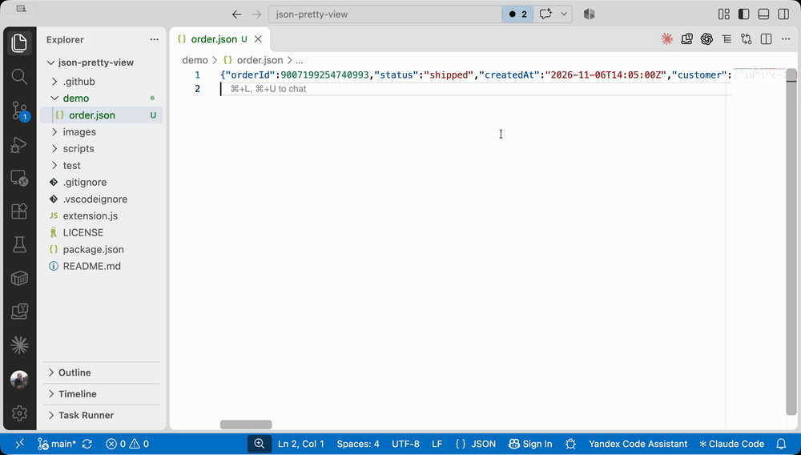
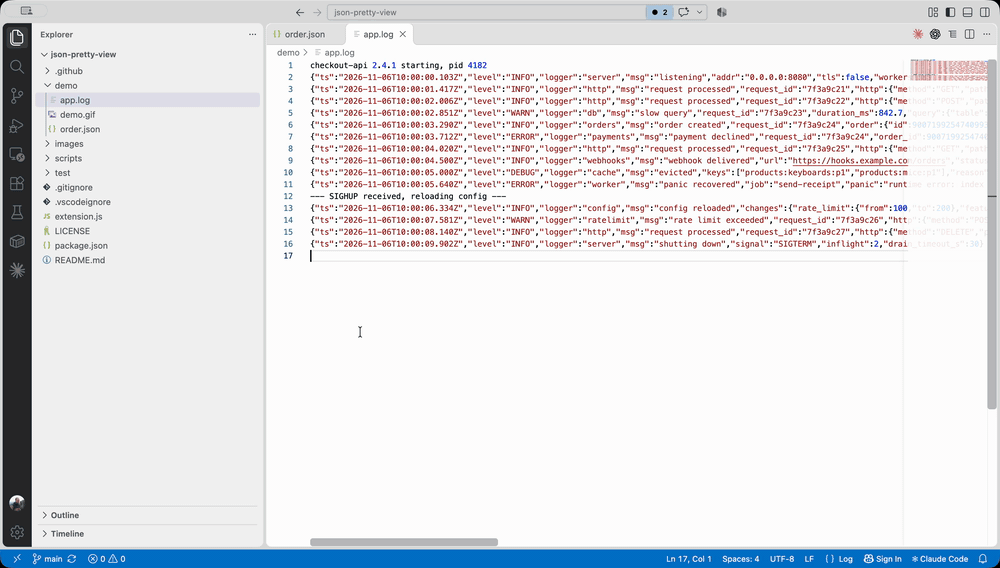

# JSON Pretty View

View minified or single-line JSON as formatted, foldable text — right in the tab where the file is open, without changing the file.

## Features

- **Same tab.** One click in the editor title bar swaps the raw file for a read-only pretty view; another click swaps it back.
- **Native editor.** The view is a regular read-only text editor, so folding, syntax highlighting and search work as usual.
- **Any file system.** Works for files opened through any provider: local disk, Remote SSH, Dev Containers, the Container Tools explorer (`containers:`), and other virtual file systems.
- **Exact values.** Only whitespace is changed. Numbers keep their original text (no rounding of 64-bit integers like `18446744073709551615`), and key order and duplicate keys are preserved.
- **JSON Lines and logs.** In `.jsonl`, `.ndjson` and `.log` files with one JSON object per line, every record opens collapsed and reads like the original line; expanding it shows only the formatted JSON. Lines that are not JSON are shown as is.
- **Escaped strings on hover.** Hover a string value in the pretty view to see it decoded: multi-line text such as stack traces with real line breaks, and JSON serialized into a string formatted as JSON.
- **Fresh content.** The file is re-read when you switch back to the tab, or on demand with the refresh button.

### JSON Lines and logs

## Usage

1. Open a JSON, JSON Lines or log file.
2. Click the tree icon in the editor title bar, or run **JSON: Toggle Pretty View** from the Command Palette.
3. Fold sections with the gutter arrows, `Ctrl+K Ctrl+0` (fold all) and `Ctrl+K Ctrl+J` (unfold all); on macOS use `Cmd`. In JSON Lines view, `Ctrl+K Ctrl+1` collapses every record back to its line.
4. Click the tree icon again to return to the raw file.

## Commands

| Command | Description |
|---|---|
| `JSON: Toggle Pretty View` | Switch the current tab between the raw file and the pretty view |
| `JSON: Refresh Pretty View` | Re-read the source file |

## Notes

- Plain JSON only; JSONC with comments is not supported.
- If the raw file has unsaved changes, it stays open and the pretty view opens next to it. The view shows the saved content.
